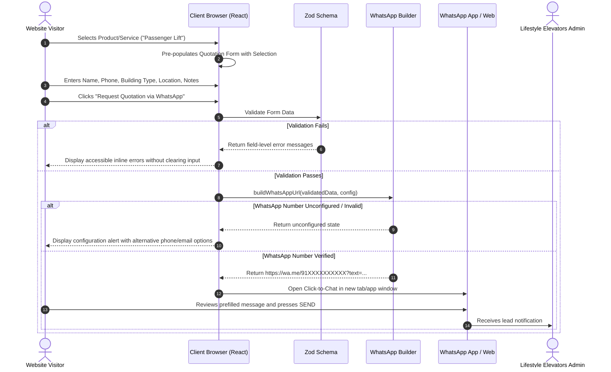

# Software Architecture Document

**Project:** Lifestyle Elevators Company Website  
**Date:** 14 October 2026  
**Author:** Lead Software Architect & Engineering Team  
**Version:** 1.0.0

---

## 1. Architectural Overview & Philosophy

The Lifestyle Elevators website is engineered as a modern, high-performance, accessible, and secure digital presence for a vertical transportation and elevator engineering firm based in Bangalore, India.

### Core Architectural Principles
1. **Server-First by Default (RSC):** Leverage Next.js App Router React Server Components for superior SEO, optimal initial page load times, and near-zero client JavaScript footprint on informational routes.
2. **Selective Client-Side Interactivity:** Client components (`'use client'`) are strictly isolated to leaves of the component tree that require browser APIs (interactive quotation forms, mobile navigation drawers, copy-to-clipboard, Web Share API, and modal dialogs).
3. **Single Source of Truth for Business Data:** Company contact details, product catalogs, service specifications, and technical dimensions are managed in strongly-typed, centralised configuration files (`src/config/company.ts`, `src/data/products.ts`, `src/data/services.ts`). No contact numbers or addresses are hardcoded in UI templates.
4. **Resilient Handoff Architecture:** The quotation funnel utilizes WhatsApp Click-to-Chat protocol without intermediate database vulnerabilities or unverified third-party API exposure. Graceful degradation is built into every external browser capability (Web Share fallback to clipboard, WhatsApp unconfigured protection).
5. **No Speculative Complexity:** Version 1 deliberately omits heavyweight dependencies such as ORMs, authentication backends, and microservices while maintaining clean interfaces to enable future integration of CRM / Postgres backends.

---

## 2. Technology Stack & Decision Rationale

| Layer | Selected Technology | Version / Spec | Rationale |
| :--- | :--- | :--- | :--- |
| **Framework** | Next.js (App Router) | Latest Stable (15.x / 14.x LTS) | Built-in SSR/SSG, automatic image optimization, nested layouts, streaming, and first-class SEO metadata API. |
| **Language** | TypeScript | Strict Mode (`5.x`) | Guarantees compile-time safety, complete typings for domain models, and prevents runtime `undefined` bugs. |
| **Styling** | Tailwind CSS | Latest Stable (v3/v4) | Utility-first CSS providing a consistent design system (colors, spacing, typography) with zero runtime overhead. |
| **Form Handling** | React Hook Form | Latest Stable | High performance, minimal re-renders, and seamless integration with uncontrolled DOM inputs. |
| **Validation** | Zod | Latest Stable | Schema-driven runtime validation with automatic TypeScript inference for quotation and contact forms. |
| **Icons** | Lucide React | Latest Stable | Crisp, accessible, tree-shakeable SVG icons adhering to modern accessibility guidelines. |
| **Testing** | Vitest + React Testing Library | Latest Stable | High-speed ESM testing runner with native TypeScript support for unit and component verification. |
| **End-to-End** | Playwright | Latest Stable | Reliable cross-browser testing for responsive layouts, navigation, and form workflows. |

---

## 3. Directory & File Organization

```
lifestyle-elevators/
├── .github/
│   └── workflows/
│       └── ci.yml               # Automated CI pipeline (lint, typecheck, tests, build)
├── docs/
│   ├── ARCHITECTURE.md          # Architectural decisions & system design
│   ├── CODING-STANDARDS.md      # Engineering standards & style rules
│   ├── SECURITY.md              # Threat modeling, headers, and secret management
│   ├── TESTING.md               # Test plans, test runner setup, coverage standards
│   ├── DEPLOYMENT.md            # Vercel & custom hosting instructions
│   ├── REQUIREMENTS-TRACEABILITY.md # PRD requirement audit matrix
│   ├── OPEN-QUESTIONS.md        # Unresolved client business decisions
│   └── IMPLEMENTATION-REPORT.md # Verification status, metrics, and progress logs
├── public/
│   ├── brochures/
│   │   └── lifestyle-elevators.pdf # Official 8-page company brochure
│   ├── images/
│   │   ├── branding/            # Logos, favicons, open-graph banners
│   │   ├── products/            # Extracted/curated product photographs
│   │   └── services/            # Extracted/curated service photographs
├── src/
│   ├── app/
│   │   ├── layout.tsx           # Global HTML structure, fonts, header & footer
│   │   ├── page.tsx             # Homepage (Hero, Highlights, Featured, Trust)
│   │   ├── globals.css          # Tailwind directives, CSS custom properties
│   │   ├── sitemap.ts           # Dynamic XML sitemap generator
│   │   ├── robots.ts            # Robots.txt configuration
│   │   ├── about/
│   │   │   └── page.tsx         # Company story, quality approach, engineering standards
│   │   ├── products/
│   │   │   └── page.tsx         # Main lift models & technical components gallery
│   │   ├── services/
│   │   │   └── page.tsx         # Manufacturing, Installation, Repairs, AMC
│   │   ├── brochure/
│   │   │   └── page.tsx         # PDF preview, direct download, and Web Share
│   │   ├── contact/
│   │   │   └── page.tsx         # Reach out, phone links, maps embed, enquiry form
│   │   └── quote/
│   │       └── page.tsx         # Full-page dedicated quotation request form
│   ├── components/
│   │   ├── layout/
│   │   │   ├── Header.tsx       # Desktop & mobile navigation container
│   │   │   ├── Navbar.tsx       # Navigation links and quotation CTA
│   │   │   ├── MobileNav.tsx    # Accessible slide-out mobile drawer
│   │   │   ├── Footer.tsx       # Company info, quick links, compliance note
│   │   │   └── FloatingWhatsApp.tsx # Configurable floating quick-contact bubble
│   │   ├── products/
│   │   │   ├── ProductCard.tsx  # Product presentation card with quote trigger
│   │   │   ├── ProductGallery.tsx # Secondary component viewer (doors, cabins, motors)
│   │   │   └── DimensionTable.tsx # Elevator standard measurements
│   │   ├── services/
│   │   │   └── ServiceCard.tsx  # Service offering presentation with quote trigger
│   │   ├── brochure/
│   │   │   ├── BrochureViewer.tsx # PDF embed & cover preview
│   │   │   └── ShareBrochure.tsx  # Native share with clipboard & WhatsApp fallbacks
│   │   ├── forms/
│   │   │   ├── QuotationForm.tsx  # Interactive quotation form (RHF + Zod)
│   │   │   └── ContactForm.tsx    # General enquiry contact form
│   │   ├── shared/
│   │   │   ├── Button.tsx       # Brand button variants (primary, secondary, outline)
│   │   │   ├── SectionHeader.tsx# Consistent section title & subtitle styling
│   │   │   ├── Badge.tsx        # Status and category badges
│   │   │   └── Modal.tsx        # Accessible dialog wrapper
│   │   └── ui/                  # Reusable UI primitives
│   ├── config/
│   │   ├── company.ts           # Centralised company info (address, phones, email)
│   │   └── site.ts              # Site metadata, canonical URLs, nav links
│   ├── data/
│   │   ├── products.ts          # Strongly typed catalog of elevators & accessories
│   │   └── services.ts          # Strongly typed descriptions of all services
│   ├── lib/
│   │   ├── validation/
│   │   │   ├── quotation.ts     # Zod schema for quotation leads
│   │   │   └── contact.ts       # Zod schema for general contact enquiries
│   │   ├── whatsapp/
│   │   │   └── buildMessage.ts  # URL generation & prefilled message formatting
│   │   └── utils/
│   │       ├── cn.ts            # Tailwind class merger (clsx + twMerge)
│   │       └── share.ts         # Web Share API & clipboard helper
│   └── types/
│       ├── product.ts           # TypeScript interfaces for products & categories
│       ├── service.ts           # TypeScript interfaces for services
│       └── quote.ts             # TypeScript interfaces for lead submissions
├── tests/
│   ├── unit/                    # Fast isolated logic tests (WhatsApp, Zod, Config)
│   └── components/              # React Testing Library DOM tests
├── e2e/                         # Playwright end-to-end test specs
├── .env.example                 # Sanitized environment variable template
├── .gitignore                   # Git ignore rules
├── .prettierrc.json             # Code formatting rules
├── eslint.config.mjs            # ESLint rules
├── package.json
└── tsconfig.json
```

---

## 4. Data Flow & Lead Handoff Workflow



---

## 5. Security & Boundary Architecture

1. **Client/Server Isolation:** No server-side secrets or privileged API keys exist in client bundles. Public variables are restricted to `NEXT_PUBLIC_` prefixes and strictly verified.
2. **HTTP Security Headers:** Implemented in `next.config.ts`:
   - `Content-Security-Policy`: Disallowing inline eval, restricting script origins.
   - `X-Frame-Options: DENY`: Preventing clickjacking.
   - `X-Content-Type-Options: nosniff`: Preventing MIME-sniffing.
   - `Strict-Transport-Security`: Enforcing HTTPS.
   - `Referrer-Policy: strict-origin-when-cross-origin`.
3. **Data Minimization:** No personal data (phone numbers, names, locations) is persisted in browser local storage or transmitted to unverified telemetry collectors.

---

## 6. Future Extension Roadmap

- **Phase 2 (Lead Management):** Introduction of Next.js Route Handlers (`/api/leads`) backed by PostgreSQL (e.g., Supabase / Neon) with Prisma / Drizzle ORM to log leads prior to WhatsApp redirection.
- **Phase 3 (Admin Dashboard):** Protected dashboard using NextAuth.js / Clerk with role-based access control (RBAC) to view quotation histories, export CSVs, and update product availability.
- **Phase 4 (Interactive Elevator Visualizer):** 3D cabin visualizer allowing customers to preview SS Gold, Matt, and Wooden cabin finishes in real-time.
